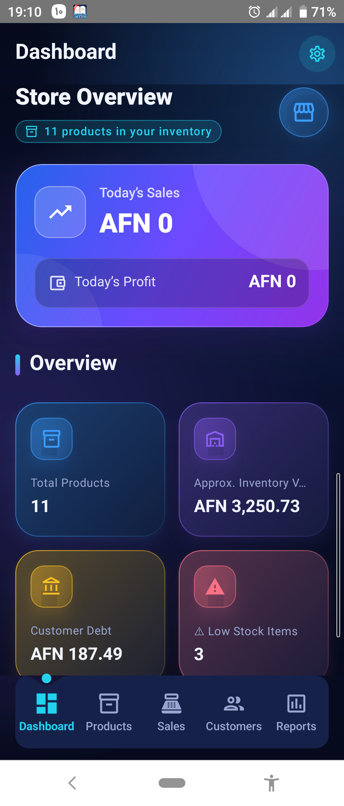
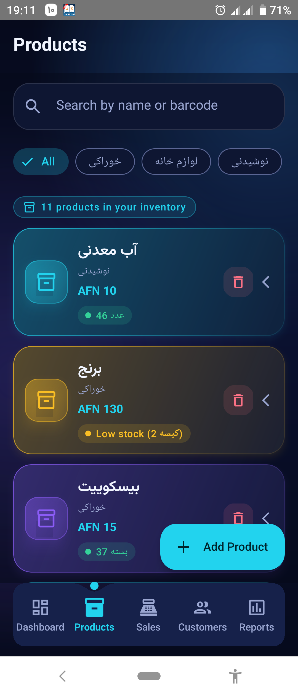
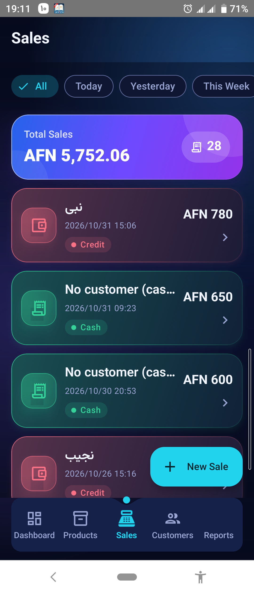
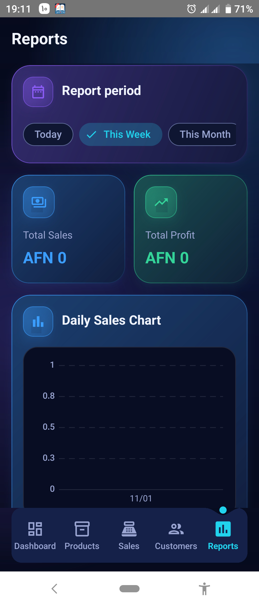
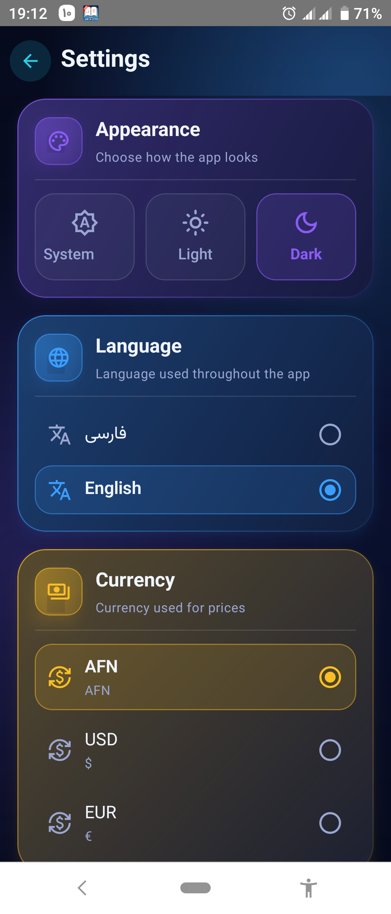
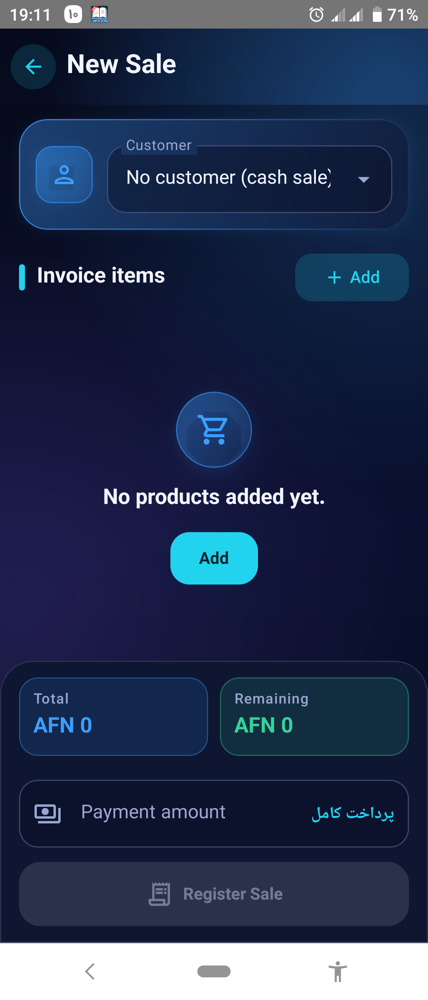

# 🛒 ShopKeeper

### Android Inventory & Sales Management Application

ShopKeeper is a modern Android application designed to simplify inventory management, product tracking, sales operations, and business reporting.

Built with modern Android development technologies, it provides a clean user interface and a structured architecture.

## ✨ Key Features

* 📦 Product Management
* 🗂️ Category Management
* 💰 Sales Management
* 👥 Customer Management
* 📊 Business Reports
* ⚖️ Weight-Based Product Sales
* 🌙 Dark and Light Theme
* 🌍 Multi-language Support
* 💱 Currency Management
* 📱 Modern Material 3 UI

## 🛠️ Technologies

* Kotlin
* Jetpack Compose
* Material 3
* MVVM Architecture
* Hilt
* Kotlin Coroutines
* StateFlow
* DataStore
* Room Database

## 🏗️ Architecture

The application follows the MVVM architecture pattern.

Main architectural components:

* UI Layer
* ViewModel Layer
* Repository Layer
* Data Layer

## 🎥 Demo

A demonstration video will be available here.

## 📸 Screenshots

### Dashboard

<!--  -->

### Products

<!--  -->

### Sales

<!--  -->

### Reports

<!--  -->

### Setting

<!--  -->

### NewSale

<!--  -->
## 🔒 License & Copyright

Copyright © 2026 Milad Qasemi.

All Rights Reserved.

This repository is provided exclusively for portfolio and demonstration purposes.

No permission is granted to copy, modify, redistribute, or commercially use this project or its materials without prior written permission.

The original application source code is not included in this repository.

## 👨‍💻 Developer

**Milad Qasemi**

Android Developer | Kotlin | Jetpack Compose

[GitHub Profile](https://github.com/miladqasemi24)
